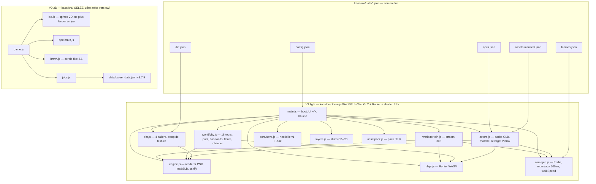

# Néo-Faille

Open world 3D en style **PSX**, cyberpunk et magie à la Dofus, pensé d’abord pour le **mobile portrait hors ligne**. Un seul jeu, monde ouvert façon Kenshi. Le combat tactique de la v3.7.9 est mis de côté : seules ses **règles et données** (stats, carrière, sorts) sont recyclées.

- Dépôt : [github.com/Poly-AAA/onyx-frontier](https://github.com/Poly-AAA/onyx-frontier)
- Branche : `main`
- Date de ce document : **21 novembre 2026, 5 h 28 (Europe/Paris)**
- Rôles : **Jean** décide et autorise toute publication · **Kaos** code dans `kaos/` · **Archy** supervise, relit chaque version et ne pousse rien sans accord

Ce README est la feuille de route que **Kaos doit suivre**, dans l’ordre. Le brief de design et l’analyse des modules restent les sources de vérité pour les chiffres et le lore :

- [design/contexte-jeu-v4.md](design/contexte-jeu-v4.md) — pitch, lore, combat, monde, PNJ, craft, métiers, économie, critères V1, feuille V2–V5
- [design/carte-modules-v4.md](design/carte-modules-v4.md) — carte Graphify du 21/11 au matin (32 fichiers, 568 nœuds). **Snapshot** : certains écarts de cette analyse sont déjà corrigés en local (voir §2)

## Sommaire

1. [Pitch et lore](#1-pitch-et-lore)
2. [État actuel de la V1 light](#2-état-actuel-de-la-v1-light)
3. [Critères d’acceptation de la V1](#3-critères-dacceptation-de-la-v1)
4. [Architecture](#4-architecture)
5. [Structure du dépôt](#5-structure-du-dépôt)
6. [Lancer le jeu, tester, construire](#6-lancer-le-jeu-tester-construire)
7. [Règles permanentes pour Kaos](#7-règles-permanentes-pour-kaos)
8. [Feuille de route — ordre des prochaines étapes](#8-feuille-de-route--ordre-des-prochaines-étapes)
9. [Règles et formules à brancher (v3.7.9 → V2)](#9-règles-et-formules-à-brancher-v379--v2)
10. [Assets 3D et crédits](#10-assets-3d-et-crédits)
11. [Documents de référence](#11-documents-de-référence)

---

## 1. Pitch et lore

**Un seul jeu, en monde ouvert.** Futur **surpeuplé, pas d’apocalypse** : une mégalopole verticale (Mega-City : tours, ponts, bas-fonds) et sa campagne (désert façon Mad Max, montagne, forêt). Ambiance cyberpunk + magie Dofus, fleurs animées au vent.

Les créatures d’allure « apocalyptique » sont validées, à condition d’avoir une **origine locale** (Faille magique, labos, mutations, cultes), pas une fin du monde. La ville tourne, surpeuplée. Technologie et magie cohabitent.

### Règle de lore (obligatoire)

Chaque faction, créature, PNJ clé ou objet notable a une **fiche de 3 lignes** :

1. **Origine** — d’où il vient (Faille magique, labo corpo, culte, mutation du désert, années 90 survivantes, magie Dofus…).
2. **Lieu** — où il vit (quartier de Mega-City, bas-fonds, désert, montagne, forêt).
3. **Rôle** — ce qu’il fait dans l’économie et les combats (métier, menace, marchand, mentor, cible de prime), et son élément (Terre / Feu / Eau / Air / Vie).

Garde-fous :

- Rien n’existe sans lieu ni rôle dans l’économie façon Red Dead.
- L’élément d’une créature découle de son origine.
- Une nouveauté ne contredit jamais une fiche existante : on l’étend ou on la remplace explicitement dans le doc.
- **Origines multiples** : une Faille principale au cœur de Mega-City, et des failles secondaires locales (désert, montagne, forêt, bas-fonds).
- Le ton peut rester décalé, mais l’origine doit être sérieuse.

Fiches types (écoles de magie, créatures) : voir [design/contexte-jeu-v4.md](design/contexte-jeu-v4.md) §1. Ces fiches ne sont **pas encore rédigées** (trou design/data, prévu pour James / V2+).

---

## 2. État actuel de la V1 light

Vérifié en local le **21 novembre 2026 à 5 h 28 (Europe/Paris)**. Rien n’est publié hors de ce dépôt. **Aucun lien de test public** n’a été mis en ligne.

> **Écart dépôt / machine.** Le `main` en ligne contient aujourd’hui le seul commit d’import initial (`f53be3d`, packs et V1 light d’alors). Les dernières corrections de Kaos (saleté par swap de texture, instancing, pack `file://`, retarget Vinrax, routes, lampes ambre) sont **présentes en local** dans `kaos/ow/` mais **pas encore poussées**. Ce README décrit l’état local courant. Kaos ne pousse le code du jeu que sur ordre explicite de Jean.

### Moteur et rendu

- **three.js** r187, **WebGPU** avec repli automatique **WebGL2**.
- Physique **Rapier** (WASM local).
- Monde : morceaux de **500 m**, stream **3×3** autour du joueur, carte de référence **870 km²** (≈ 59×59 morceaux), même graine = même monde.
- Relief V1 : **Perlin généré par code** (consigne Jean, 21/11 à 4 h 17). Le **Heightmap Level Generator** (m-w-marker, MIT, export glTF) est **reporté** à la zone de départ (voir §8.2).
- Ville verticale dans le morceau central : **18 tours**, rue aérienne, pont, bas-fonds, chantier, parcelle de fleurs au vent, cycle jour/nuit de **24 min**.
- Rendu **PSX** validé par Jean / Sou : résolution interne **240×426** (upscale nearest), snapping des sommets, UV affines, tramage Bayer 4×4, quantification **RGB555**, brouillard de sommets. Les contours toon et les ombres PCF 2048 ont été **retirés** (gain de perf).
- Routes : asphalte sans marquage par défaut, **pointillés jaunes uniquement sur l’axe des rues**, rambarde néon rose **retirée**, lampadaires **ambre** `#ffd89a`.
- Saleté : **4 paliers** (0–1) par **swap de texture** sur le mesh (plus de plan superposé, plus de zébrures). Rues et bâtiments se salissent avec le temps (plus vite dans les bas-fonds) ; vêtements, armes et persos en combat, à la poussière et au travail ; véhicules selon la distance et le biome. API `addDirt` / `walk(biome)` / `vehicle(distance, biome)` / `clean()` (stub). Données dans `kaos/ow/data/dirt.json`, état enregistré dans `neofaille.v1`.

### Packs PSX gratuits intégrés tels quels

Aucun perso généré. Packs itch.io utilisés **sans retouche** (FBX convertis en GLB si besoin) :

| Rôle | Pack | Notes |
|---|---|---|
| Joueur | CSAF — PSX Characters Sampler (`csaf-patrol`) | 1,75 Mo, **46 clips** (marche, idle, assis, interaction, ramasser, coup…) |
| PNJ | Sh4rkDev — office worker, nurse | Idle / Walk / Run / Talk / Wave / Sit |
| PNJ | LowPoly Lanka — tuk-tuk driver | |
| PNJ | Vinrax — cop, casual, secretary | Crédit obligatoire. Clips CSAF **retargetés à l’exécution** (assets intacts). Rendu un peu raide. |
| Véhicules | reodesuxz — taxi, police, moto | Attribution non requise, pas de redistrib |
| Véhicule volant | MBDesigns — Hover Car | CC0 (gameplay volant prévu en V4) |
| Décor urbain | valsekamerplant — URBAN | CC0 |
| Industrie / bas-fonds | godgoldfear — Industrial | **CC-BY 4.0, crédit obligatoire**, placé hors des rues |
| Nature | Elegant Crow — arbre, buisson | CC0, crédit apprécié |

Écartés (dans `kaos/_unused_assets/`) : Imersa (Blend seul), CSAF complet (trop lourd), Elbolilloduro, Vinrax Skeleton (vérification d’âge 18+). Benceaki, KAG3D et MikeRoe (payants) sont **abandonnés**.

Bouton **Crédits** en jeu + [`kaos/ow/CREDITS.md`](kaos/ow/CREDITS.md) et [`assets3d/CREDITS.md`](assets3d/CREDITS.md).

### Budget, tests, perf (local)

| Critère | Plafond | Mesure (5 h 28) |
|---|---|---|
| Dossier livrable | ≤ 12 Mo | **11,26 Mo** (peu de marge) |
| JS minifié (three.js compris) | ≤ 1,5 Mo | **1,25 Mo** |
| Chargement initial | ≤ 8 Mo | **3,83 Mo** (`pack.js` 2,58 Mo, gzip+base64) |
| Tests Node | tous verts | **9/9** (cœur, saleté, retarget) |
| Playwright hors ligne | 0 requête, 0 sprite 2D, 0 erreur, pas de débordement 360/320 px | OK |
| Draw calls | — | **≈ 150–192** (instancing des poteaux, lampes, bancs ; fusion par matériau du décor industriel ; matériaux partagés). Avant instancing : 1086 |
| Triangles | — | ≈ 21–41 k selon la vue |
| i/s headless (SwiftShader, non fiable) | ≥ 30 fps sur POCO (à mesurer) | 30–46 en headless ; **pas de mesure sur un vrai appareil** |

Captures portrait 393×873 dans `kaos/ow/screenshots/` : `05-persos-marchent`, `06-routine-pnj`, `07-objets-vehicules`, `08-route`, `09-propre`, `10-sale`, `11-ui-320`.

### Limites connues (à traiter dans l’ordre du §8)

- Retarget Vinrax un peu **raide**.
- Fusion de meshes limitée au **pack industriel** (elle écrasait les voitures).
- **Peu de marge** sur les 12 Mo (11,26 Mo).
- Perf **POCO F8 Pro** non mesurée (le headless SwiftShader ne compte pas).
- Générateur de relief pour la **zone de départ** reporté (Perlin en V1, consigne Jean).
- Règles de **carrière et de combat v3.7.9** encore bloquées dans la V0 2D (`kaos/src/`, `kaos/data/`) : **aucun import** vers `kaos/ow/`.
- Affichage de l’**équipement** (12 emplacements) : pack Benceaki abandonné, **décision de Jean en attente**.
- Trou **désert** : pas de pack désert gratuit clairement licencié trouvé.
- `kaos/ow/dist/` est un build local ; il n’est pas forcément versionné tel quel sur `main`.

---

## 3. Critères d’acceptation de la V1

Les 12 critères du [brief v4 §9](design/contexte-jeu-v4.md) (périmètre décidé, critères proposés puis suivis). État au 21/11 5 h 28 :

| # | Critère | État |
|---|---|---|
| 1 | S’ouvre hors ligne (`file://` ou dossier local), 0 requête réseau, aucun serveur | **OK en local** : double-clic sur `kaos/ow/dist/index.html` (JSON inlinés, GLB et wasm dans `pack.js`). Vérifié Playwright, réseau coupé |
| 2 | POCO F8 Pro, Chrome Android, portrait : médiane ≥ 30 fps pendant 60 s de marche, 10 min sans plantage | **Non mesuré** — priorité V1.1 |
| 3 | WebGPU si disponible, sinon repli WebGL2 automatique, même scène ; moteur affiché dans les réglages | **OK** |
| 4 | Morceaux 500 m, 3×3, pas de saccade > 100 ms au changement de morceau ; même graine = même monde ; coordonnées valides sur 870 km² | **OK** en Perlin. Raccord des tuiles glTF du générateur **non exercé** |
| 5 | Ville basique : ≥ 10 tours, 1 pont, 2 niveaux, post-traitement, ≥ 1 image de chantier | **OK** (18 tours). Le toon a été remplacé par le **shader PSX** validé par Jean |
| 6 | 2 persos qui marchent : joueur (toucher, chemin sur le relief, caméra iso, vitesse = formule PM, PM 4 = base) + 1 PNJ en boucle scriptée, animation de marche | **OK**, et au-delà (packs branchés, plusieurs PNJ) |
| 7 | Cycle jour/nuit 24 min ; fleurs au vent sur ≥ 1 parcelle | **OK** |
| 8 | Sauvegarde position + heure dans `neofaille.v1` (+ `.bak`) ; les anciennes sauvegardes ne sont jamais effacées | **OK** (+ état de saleté) |
| 9 | UI : aucun débordement à 360 et 320 px, menus en texte, boutons +/−, pas de croix directionnelle | **OK** (libellés raccourcis : Marcher, Détruire, Cam −/+, Rot −/+) |
| 10 | Dossier ≤ 12 Mo, JS minifié ≤ 1,5 Mo, chargement initial ≤ 8 Mo | **OK**, marge dossier faible |
| 11 | Tests Node (adressage, déterminisme, vitesse PM, sauvegarde) + captures 393×873 | **OK** (9/9, captures à jour) |
| 12 | Aucun sprite 2D chargé en jeu ; `CREDITS.md` complet | **OK** avec les packs gratuits (Benceaki / KAG3D abandonnés, remplacés) |

Périmètre V1 : moteur 3D + relief en morceaux + ville basique + persos qui marchent. **Pas de combat, de métier ni de LLM en V1.**

---

## 4. Architecture

Deux arbres **sans aucun lien de code** entre eux. La V0 2D est **gelée** : on n’y ajoute plus de feature, on n’y charge plus de sprite en « jeu », et on ne la lance pas comme livrable. On y puise uniquement les **règles et données** à relier en V2.



Flux runtime V1 : `boot()` charge les JSON (ou le pack inliné) → moteur / physique / générateur / terrain / ville / acteurs → boucle : jour-nuit 24 min, `phys.step`, acteurs, `terrain.update` (1 morceau par frame), caméra, `eng.render`. Sauvegarde auto toutes les 30 s.

La carte Graphify du matin (ombres 2048, contours, GLB manquants, file:// cassé, JS à 1,59 Mo) est dans [design/carte-modules-v4.md](design/carte-modules-v4.md). Elle reste utile pour le pont V0↔V1 et le relief pré-généré, mais les chiffres de perf et d’assets sont **périmés** : se fier au §2 de ce README.

---

## 5. Structure du dépôt

```
onyx-frontier/
├── README.md                 ← ce fichier (feuille de route)
├── design/
│   ├── contexte-jeu-v4.md    ← brief final (lore, règles, critères, V2–V5)
│   └── carte-modules-v4.md   ← analyse Graphify (snapshot 21/11 matin)
├── assets3d/
│   ├── CREDITS.md            ← licences de tous les packs itch
│   ├── candidates.md         ← classement des packs gratuits
│   └── zips/                 ← archives d’origine (Git LFS)
├── kaos/
│   ├── ow/                   ← V1 light 3D PSX  ★ livrable actuel
│   │   ├── dist/             ← build hors ligne (index.html + ow.js + pack.js)
│   │   ├── src/              ← moteur, acteurs, monde, saleté, PSX
│   │   ├── data/             ← JSON de pilotage (config, biomes, dirt, PNJ…)
│   │   ├── tests/            ← tests Node (cœur, saleté, retarget)
│   │   ├── tools/            ← build.mjs, shots.py, proof.py
│   │   ├── assets/           ← GLB runtime (persos, props, véhicules)
│   │   ├── screenshots/      ← captures 393×873
│   │   ├── CREDITS.md
│   │   └── README.md         ← lancer / données / réglages PSX
│   ├── src/                  ← V0 2D gelée (cerveau, baston, métiers)
│   ├── data/                 ← career-data.json, generated-spells.json
│   └── _unused_assets/       ← packs écartés, ne pas réimporter sans GO
├── bots/                     ← bots annexes (james : squelette vide)
├── omniroute/                ← notes de planification
├── phase0/                   ← manifeste de référence ancien
└── references/               ← références de combat préexistantes
```

Les gros fichiers (`assets3d/zips/`, certains GLB) passent par **Git LFS**. Le dépôt est **public** : ne pas y remettre un pack dont la licence interdit la redistribution des fichiers d’origine (plusieurs licences itch le interdisent). Les zips déjà poussés le sont sur décision explicite de Jean.

`HANDOFF.md` et `STATUS.md` à la racine datent de la phase 0 (7 novembre) et ne décrivent plus l’état actuel.

---

## 6. Lancer le jeu, tester, construire

### Jouer hors ligne (recommandé)

Double-clic sur [`kaos/ow/dist/index.html`](kaos/ow/dist/index.html) : aucun serveur, aucune requête réseau. Si le dossier `dist/` n’est pas présent (clone frais sans build), lancer d’abord `npm run build`.

### Développer

```bash
cd kaos/ow
npm install          # une fois
npm run build        # → dist/index.html + dist/ow.js + dist/pack.js
npm test             # tests Node (9/9 attendus)
npm run serve        # http://localhost:8798  (serveur statique Python, pas de LLM)
npm run shots        # Playwright 393×873, réseau externe coupé → screenshots/
```

La V0 2D (`cd kaos && npm start`) n’est **pas** le livrable. Elle expose encore un proxy LLM (`server.mjs`) : **exclu de la V1**, à ne pas embarquer dans le pack mobile.

### Contrôles

- Toucher / clic : aller à cet endroit (chemin sur le relief).
- Deux doigts : zoom (pinch) + rotation ; molette = zoom, Maj+molette = rotation.
- ZQSD / WASD / flèches ; A / E = tourner la caméra.
- Boutons texte uniquement, **+/− jamais de sliders** : Cam −/+, Rot −/+, PM −/+, Mode (Marcher / Détruire), Sauver, Crédits.
- Vitesse de marche = base × (1 + 0,05 × (PM − 4)) ; PM 4 = vitesse de référence.
- Sauvegarde : `localStorage` clé `neofaille.v1`, copie `neofaille.v1.bak`. Les anciennes sauvegardes ne sont jamais effacées.

### Preuves demandées à chaque version

- `npm test` vert.
- Captures portrait **393×873**, plus contrôle d’overflow à **360 et 320 px**.
- Budget dossier / JS / chargement mesuré et écrit dans le rapport.
- Analyse **codegraph** (Graphify) à chaque version livrée.
- Aucune publication (Pages, lien public, push de build jouable « officiel ») **sans oui de Jean**.

---

## 7. Règles permanentes pour Kaos

Ces règles restent en vigueur d’une version à l’autre. Kaos ne les contourne pas, même pour un proto.

1. **100 % 3D PSX, zéro sprite 2D** chargé en jeu (joueur, PNJ, créatures, véhicules, UI décorative). Les sprites Fantasy Creator et l’équipement pixel ne servent plus qu’à recycler des **données** (stats, noms, sorts).
2. **Packs gratuits uniquement**, intégrés **tels quels**. Pas de perso généré, pas de pack payant (Benceaki, KAG3D, MikeRoe abandonnés). Tout nouvel asset est relevé dans `CREDITS.md` (auteur, pack, lien, licence, fichiers) **avant** d’être branché. **Vinrax** et **godgoldfear** (CC-BY 4.0) sont crédités **en jeu** et dans les markdown.
3. **Boutons +/−, jamais de sliders.** Menus en **texte**. Aucun débordement à **360 ni 320 px** en portrait.
4. **Mobile hors ligne d’abord** : `file://` ou dossier local, 0 requête réseau, 0 CDN, 0 serveur LLM dans le livrable.
5. **`.bak` avant toute réécriture** d’un fichier existant. On ne commite pas les `.bak` (locaux, voir `.gitignore`).
6. **Aucune publication** (lien de test, GitHub Pages, store, push d’une « release ») sans **oui explicite de Jean**.
7. **Analyse codegraph** à chaque version livrée.
8. **Chaque changement = une nouvelle version** (pas de fourre-tout). Les modèles peu chers codent ; **Archy relit** avant de considérer le travail terminé.
9. Rien en dur : le gameplay se pilote par les JSON de `kaos/ow/data/`.
10. Budget : dossier ≤ **12 Mo**, JS minifié ≤ **1,5 Mo**, chargement initial ≤ **8 Mo**. On ne les dépasse pas « pour cette fois ».
11. Sauvegardes versionnées (`neofaille.v1` + `.bak`) : jamais d’écrasement des anciennes.
12. Lore : toute nouvelle faction, créature, PNJ clé ou objet notable a sa fiche en 3 lignes **avant** d’entrer en jeu.
13. La V0 2D (`kaos/src/`) reste **gelée**. On n’y patch pas le rayon du cercle ni les sprites ; on prépare l’interface dans `ow/` (couche C6, données reprises).

---

## 8. Feuille de route — ordre des prochaines étapes

Kaos enchaîne **dans cet ordre**. Il ne commence pas une étape suivante tant que l’étape en cours n’est pas relue par Archy, et il ne publie rien sans Jean. Les numéros V1.1, V1.2, V2… sont les versions de livrable.

### 8.1 — V1.1 : tenir la V1 sur un vrai téléphone

Objectif : valider (ou corriger) la V1 light **sur le POCO F8 Pro** de Jean, sans nouvelle feature.

1. **Mesure de perf sur le POCO** (bloque le critère V1.2). Chrome Android, portrait, 60 s de marche en ville, médiane ≥ 30 fps, 10 min sans plantage. Relever aussi draw calls, triangles, mémoire, WebGPU vs WebGL2. Le headless SwiftShader **ne compte pas**. Le lien de test ou le mode de transfert se fait **seulement avec l’accord de Jean**.
2. Si la médiane passe sous 30 fps : d’abord des baisses de coût **sans changer le look PSX** (moins d’instances visibles, distance de dessin, fusion supplémentaire **sans casser les véhicules**). Pas de retour des ombres 2048 ni des contours. Tout réglage qualité passe par des **boutons +/−**, pas un slider. Un preset qualité n’est codé qu’avec un GO d’Archy / Jean.
3. **Marge de poids.** Le dossier est à 11,26 / 12 Mo. Avant d’ajouter le moindre GLB : mesurer, compresser, ou retirer un asset de runtime. Ne pas réimporter Elbolilloduro, le sampler CSAF complet ou Imersa « pour voir ».
4. **Raideur du retarget Vinrax.** Améliorer le retarget d’exécution (clips CSAF → rig Vinrax) **sans retoucher les assets**. Si le résultat reste mauvais, le signaler à Jean plutôt que d’éditer les FBX.
5. Documenter clairement dans le rapport V1.1 ce qui est encore ouvert : décision **affichage de l’équipement**, générateur de relief, pont carrière/combat.

### 8.2 — V1.2 : zone de départ, routines, équipement

Quand la V1.1 est validée (ou que Jean tranche autrement) :

1. **Décision équipement (attente Jean, ne pas inventer).** Le pack Benceaki (3 corps, 21 fringues, 12 emplacements) est abandonné. Kaos n’invente pas un nouveau mapping 12 slots, n’achète rien, et ne génère pas de persos. Il prépare les options (afficher les stats seules, attacher des props d’armes aux mains, réutiliser des pièces déjà dans les packs gratuits) et **attend le choix de Jean** avant de coder l’affichage.
2. **Routines PNJ de classe 2** (métiers scriptés) dans `ow/` : horaires, trajets sur le relief, animations déjà disponibles (marche, idle, assis, interaction). Pas encore d’IA mémoire (classe 3 = V3). S’appuyer sur le cerveau V0 (`npc-brain.js`) pour les *données* de besoins / routine, pas pour le rendu 2D.
3. **Zone de départ au Heightmap Level Generator** (m-w-marker, MIT) : 3×3 morceaux de 500 m, dont celui de la ville, export glTF dans `kaos/ow/assets/terrain/`, bords raccordés, priorité des tuiles pré-générées sur le Perlin (`terrain.json`). Vérifier le raccord dès le premier export. Le Perlin reste le repli pour le reste des ≈ 3 481 morceaux.
4. **Trou désert.** Aucun pack désert gratuit clairement licencié n’a été trouvé ([candidates.md](assets3d/candidates.md)). Pour la campagne proche : composer avec nature, roches industrielles et textures sol **déjà présentes**, ou proposer à Jean un pack gratuit nouvellement vérifié — jamais un achat silencieux.

### 8.3 — V2 : combat temps réel, carrière, téléphone

Pont **obligatoire** entre les règles v3.7.9 (encore dans `kaos/src/` et `kaos/data/`) et le moteur `ow/`. Décider l’interface **avant** de recoder : reprendre `career-data.json`, `roguelite.js`, `spell-lab.js` dans `ow/data/` (ou module partagé), et implémenter la couche `Layers.C6_combat` aujourd’hui stubée. Ne pas patcher le proto 2D (`brawl.js` rayon fixe 2,6).

Livrables V2, dans cet ordre interne recommandé :

1. **Cercle de combat temps réel** selon la formule du §9 (rayon ×1 / ×1,3 / ×1,6, borné 5–16 m, réduit à l’espace libre). Grille visuelle seulement.
2. **Stats en temps réel** : barre d’énergie PA (remplissage 15 s, coûts de sorts inchangés), charges d’esquive PM, vitesse de marche déjà en place, fenêtre de **combo 1,5 s**. Reprendre érosion 10 %, dos +10 % (cône 135°), ligne de vue −10 %, IA qui recule sous 30 %, double attaque, PV ×4 / dégâts ×0,75.
3. **Animations d’attaque, de dégâts et de KO** à partir des **clips déjà dans les packs** (CSAF en priorité). Pas de nouveaux persos générés.
4. **Spectateurs** et bulles de commentaire (façon 2K / Chappelle) : les curieux s’attroupent, les peureux fuient ; le contact avec le cercle inflige des dégâts.
5. **Carrière et ligue** : calendrier, classement, contrats / sponsors, combat de ligue, données `career-data.json` telles quelles. Mort **Héritier** partout, rue comprise.
6. **Téléphone façon GTA** (explicitement en V2 dans le brief).
7. **3 métiers RP prioritaires**, chacun avec un **arc narratif**. Les 18 métiers de la v3 sont gardés en data, mais seuls 3 arcs sont jouables en V2.
8. Continuer le système de **saleté** : hooks combat et travail déjà prévus ; pas de nettoyage magique implicite.

Hors V2 : LLM serveur, monde entier, craft lourd, IA mémoire récursive.

### 8.4 — V3 : PNJ qui se souviennent, économie, véhicules au sol

1. PNJ en **3 classes** : (1) bots inertes / figurants, (2) métiers scriptés déjà amorcés en V1.2, (3) PNJ clés avec **IA à mémoire récursive** (résumés de résumés, score d’importance, journaux, contexte lieu / météo / événements). Évolution du cerveau V0 (mémoire bornée à 10), pas une feuille blanche.
2. **Psychologie liée aux vêtements et au statut** : la tenue du joueur change l’accueil, la peur et les prix — même si l’affichage 3D des 12 slots n’est pas celui de Benceaki.
3. **Économie façon Red Dead** : chaque action laisse une trace (témoins, réputation par quartier, primes, prix qui bougent).
4. **Véhicules au sol** jouables (taxi, police, moto déjà présents en décor). Physique, saleté selon kilomètres et biome, places de stationnement.

### 8.5 — V4 : craft, biomes, créatures, volant

1. **Craft façon Cataclysm** : implants, mods, atelier libre, invention. Progression du bricolage (les robots eux-mêmes sont V5).
2. Biomes **désert / montagne / forêt** réellement traversables, pas seulement un bruit de sol. Créatures avec fiche lore + asset 3D déjà licencié (rien d’inventé sans pack).
3. **Motos** jouables si pas déjà en V3, et **véhicules volants** (Hover Car CC0 déjà dans le runtime, à rendre jouable).

### 8.6 — V5 et après

- Robots (aboutissement du craft).
- **18 métiers** complets, contrats négociés.
- Dark web, boutiques en ligne (données déjà prévues dans la v3).
- Monde de **870 km² rempli** (POI, PNJ, failles secondaires), toujours en morceaux de 500 m, 3×3 en mémoire.

---

## 9. Règles et formules à brancher (v3.7.9 → V2)

Repris du brief v4. Kaos n’implémente le cercle qu’en V2, mais l’interface (schémas `ow/data/schemas/`, `layers.js` C6) peut être préparée dès la V1.2.

### Combat temps réel (« Delinquents »)

| Élément | Règle |
|---|---|
| Tour | 1 tour Dofus = **15 s** |
| PA | Barre d’énergie qui se remplit en **15 s** ; le coût des sorts reste en PA |
| PM | Esquives : 1 charge par 2 PM (⌈PM/2⌉). Vitesse de marche × (1 + 0,05 × (PM − 4)) : −10 % à PM 2, +20 % à PM 8, PM 4 = base |
| PO | Portée en **mètres réels** (1 case = 1,5 m) |
| Combos | Fenêtre de **1,5 s** |
| Cercle | Rayon = (portée max des combattants + 3 m) × **1** (1v1) / **1,3** (3v3) / **1,6** (5v5), borné entre **5 et 16 m**, réduit à l’espace libre de la carte |
| Spectateurs | Repoussent dans le cercle avec des dégâts ; bulles de commentaire |
| Grille | Visuelle seulement, plus un système |
| Repris | Érosion 10 %, dos +10 % (cône de 135°), ligne de vue −10 %, IA qui recule sous 30 %, double attaque, PV ×4 / dégâts ×0,75 |

Fuite : sortir du cercle pendant 3 s (règle déjà présente en V0, à reprendre).

### Stats et progression (inchangées)

- Stats sur 300 points, création au d8, niveau 50.
- PVmax = 50 + 5 × (niv − 1) + (Vit − 5).
- Éléments Terre / Feu / Eau / Air / Vie et leurs 3 rôles.
- XP de sort par lancer, pondérée ×0,5–×2 ; paliers d’animation en Fibonacci ; plafond de bonus +100 % ; critique ×1,5 à part.
- Régénération 10 % / min, potions, potion de fuite, soignants.
- 1 jour = 24 min réelles ; match lancé quand on veut.
- Toucher pour bouger, glisser pour esquiver.
- Mort **Héritier** partout, rue comprise.
- 18 métiers (data v3 conservée) ; carrière, ligues, contrats, barre d’intérêt, ADN d’équipe.
- Butin, boutiques en ligne, dark web, machine à sous 3 lancers / jour (V2+ / V5 selon le sujet).

Sources à ne pas réécrire : `kaos/data/career-data.json`, `kaos/data/generated-spells.json`, `kaos/src/core/` (copie des règles v3.7.9).

---

## 10. Assets 3D et crédits

Inventaire et licences : [`assets3d/CREDITS.md`](assets3d/CREDITS.md) (tableau complet, citation des pages itch du 21/11/2026) et [`assets3d/candidates.md`](assets3d/candidates.md) (classement, formats, tailles). Crédits runtime : [`kaos/ow/CREDITS.md`](kaos/ow/CREDITS.md).

**Crédit obligatoire en jeu et dans les fichiers :**

- **Vinrax** — PSX Cop, Casual Male, Secretary (« just credit me »).
- **godgoldfear** — PSX Industrial Environment Asset Pack, **CC-BY 4.0**.

Crédit apprécié : LowPoly Lanka, Elegant Crow, Sh4rkDev, Jashi (si utilisé plus tard).

Rappel licence : plusieurs packs **interdisent de republier ou revendre les fichiers d’origine** (CSAF, Sh4rkDev, Lanka, reodesuxz, Imersa, Elbolilloduro Characters…). Le dépôt public contient les zips sur décision de Jean ; Kaos ne redistribue pas ces archives ailleurs, et n’ajoute un nouveau zip public qu’après vérification de licence + oui de Jean.

Moteur bundlé : three.js r187 (MIT), Rapier 0.21 (Apache-2.0).

---

## 11. Documents de référence

| Document | Rôle |
|---|---|
| [design/contexte-jeu-v4.md](design/contexte-jeu-v4.md) | Brief final : lore, combat, monde 870 km², PNJ, craft, métiers, économie, 12 critères V1, V2–V5 |
| [design/carte-modules-v4.md](design/carte-modules-v4.md) | Analyse Graphify du 21/11 au matin (snapshot ; certains écarts sont déjà clos) |
| [kaos/ow/README.md](kaos/ow/README.md) | Lancer la V1, JSON de données, réglages du shader PSX |
| [kaos/ow/CREDITS.md](kaos/ow/CREDITS.md) | Crédits des assets **effectivement** en jeu |
| [assets3d/CREDITS.md](assets3d/CREDITS.md) | Toutes les licences relevées sur itch |
| [assets3d/candidates.md](assets3d/candidates.md) | Packs gratuits examinés, trou désert, URLs |
| [kaos/README.md](kaos/README.md) | V0 2D gelée (cercle, métiers, cerveau) — historique, pas le livrable |

Questions encore ouvertes (ne pas trancher à la place de Jean) : affichage de l’équipement sans Benceaki ; date et moyen du test POCO ; éventuellement un pack désert gratuit s’il en apparaît un licencié clairement.
