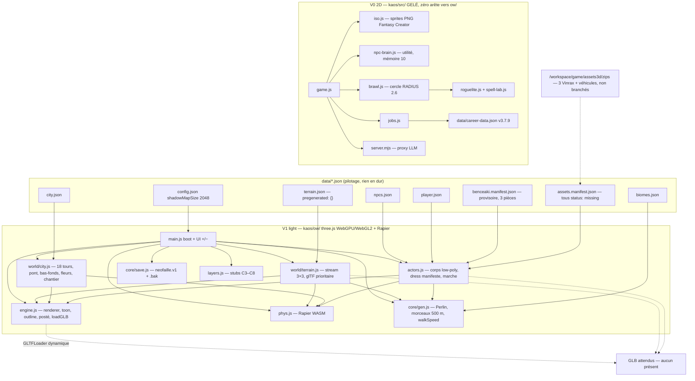

# Carte des modules — Neo-Faille v4

Analyse Graphify (codegraph) du 21/11/2026, Europe/Paris. Index : `/workspace/analysis/kaos-snapshot/` (copie lecture seule de `/workspace/game/kaos/`, hors `node_modules`/`dist`) — **32 fichiers, 568 nœuds, 1 773 arêtes**. Aucun import entre `ow/` (V1 light 3D) et `src/` (V0 2D iso). James (`/workspace/game/bots/james/`) : squelette vide (README seul). Aucun fichier de jeu modifié.

## 1. Graphe des modules et dépendances

Flux runtime V1 : `boot()` charge les JSON → `createEngine` / `createPhysics` / `createWorldGen` / `createTerrain` / `createCity` / `createPlayer`×2 / `createWalker` → boucle : jour-nuit 24 min, `phys.step`, acteurs, `terrain.update` (1 morceau/frame), caméra, `eng.render`. Sauvegarde auto 30 s.

## 2. Écarts vs design doc v4

| Exigence v4 | Code | Écart |
|---|---|---|
| 100 % 3D PSX, **aucun sprite 2D chargé en jeu** | V1 `ow/` : primitives only, confirmé `ow/CREDITS.md`. V0 charge encore des PNG : `src/render/iso.js:6-9` (`assets/chars/*_Idle/Walk.png`, 2,6 Mo) | Le proto 2D reste dans le même arbre ; à isoler / ne plus lancer en « jeu » |
| Joueur Benceaki (corps + fringues via manifeste réel) + 1 PNJ KAG3D/Vinrax | `actors.js` = mannequins low-poly + 3 placeholders. `benceaki.manifest.json` inventé (pas le JSON du pack). Tous les GLB `status: "missing"`. Packs payants abandonnés (décision Sou). Zips Vinrax dans `assets3d/zips/` **non dépaquetés, non référencés** | Manifeste Benceaki caduc ; mapping 12 slots / 21 fringues sans pack ; pas de chargeur FBX (GLB seulement, `engine.js:77`) |
| Relief : 3×3 de 500 m pré-générés (Heightmap Level Generator) + repli graine, bords raccordés | Stream 3×3 + Perlin OK (`terrain.js:57-62`, `gen.js:23-37`). `terrain.json` `pregenerated: {}`. Aucun `assets/terrain/*.glb` | Tuiles m-w-marker jamais importées ; raccord glTF **non testé** (le procédural, lui, partage les sommets de bord) |
| Toon sur éclairage physique + images de chantier | Présent : `MeshToonNodeMaterial` + postérisation (`engine.js:37-74`), chantier (`city.js:87-92, 109-120`) | OK V1 |
| Offline, **zéro serveur**, file:// ou dossier local, 0 requête réseau | V1 : `npm run serve` = http.server statique (pas de LLM). Mais `main.js:12` fait `fetch("data/...")` : **file:// casse** souvent. V0 `server.mjs` + `dialogue.js:17,58` (`/api/npc`) toujours là, exclu de la V1 | Critère file:// non tenu ; serveur V0 à ne pas embarquer |
| JS minifié ≤ 1,5 Mo ; dossier ≤ 12 Mo ; chargement ≤ 8 Mo | `ow.js` 0,99 Mo + chunk WebGPU 0,39 Mo + GLTF 0,21 Mo = **1,59 Mo au total** (initial sans GLTF ≈ 1,38 Mo). `rapier.wasm` 3,0 Mo. Livrable hors node_modules ≈ 4,7 Mo | Budget JS limite / dépassé si on compte tous les chunks |
| 2 persos qui marchent : 1 joueur + 1 PNJ scripté, anim marche, chemin sur le relief | `main.js:25-30` : **2 joueurs physiques** + **2 walkers**. Walkers sans Rapier (`actors.js:83-98`), waypoints Y=0/10, traversent les tours. Si un GLB arrive, `root.clear()` jette le rig et `animate()` tourne dans le vide (pas d'`AnimationMixer`) | Plus que le périmètre ; collision PNJ absente ; clips Mixamo non branchés |
| Carrière / stats / sorts v3.7.9 recyclés | Présents **uniquement en V0** (`jobs.js:6` → `career-data.json`, `brawl.js` → `roguelite.js`). OW n'importe rien de `src/core` ni de `data/` racine. `Layers.C6_combat` stub (`layers.js:10`) | Pas d'interface partagée pour la V2 (cercle, PA/PM, Héritier) |
| Cercle ×1 / 1,3 / 1,6, 5–16 m | V0 : `RADIUS = 2.6` fixe (`brawl.js:9`) | À aligner en V2, pas en V1 |
| Doc §6 bis / §11 : packs non téléchargés, licences à confirmer | Faux depuis : 4 zips gratuits + `design/licences-assets3d.md` + `assets3d/CREDITS.md`. `ow/CREDITS.md` et le doc v4 sont en retard | Doc et crédits OW à resynchroniser |
| Fiches lore (écoles, créatures), métiers RP | Absentes. James prévu pour le JSON, dossiers vides | Pas un bug moteur ; trou design/data |
| ≥ 30 fps POCO F8 Pro | Risque : `shadowMapSize: 2048` + `PCFShadowMap` (`config.json:17`, `engine.js:11-24`), coque inversée sur **chaque** tour (`city.js:82` + `engine.js:51-61`), 900 fleurs instanciées, antialias, pixelRatio 1,5, post-process, jusqu'à 8 morceaux forêt × 160 arbres, caméra `far=4000` | À mesurer avant d'ajouter des GLB |

## 3. Points à revoir en priorité

1. **Pipeline assets 3D (bloque le critère « 2 persos PSX »).** Manifestes toujours calés sur Benceaki/KAG3D manquants (`assets.manifest.json:48-76`, `benceaki.manifest.json:1-3`, `actors.js:37-49, 83-88`). Zips Vinrax + véhicules prêts mais hors arbre OW. `dress()` n'applique pas `hides[]`. Pas de chargeur FBX. Remplaçants gratuits (Jashi 3 pièces) ≠ 21 fringues — le mapping 12 slots du doc v4 n'a plus de pack source.
2. **Perfs mobile — ombres 2048 + outline coque.** `engine.js:11-24` et `config.json:13-19` : PCF 2048, soleil qui suit le joueur, `outline()` sur bâtiments *et* membres (`actors.js:7`, `city.js:33,59,82`). Plus postérisation (`engine.js:63-74`) et 900 fleurs (`city.json` `flowers`). Risque direct sur le critère ≥ 30 fps. Mesurer avant d'ajouter meshes itch.io.
3. **Deux arbres sans pont.** Graphify : 0 arête `ow/` ↔ `src/`. Règles v3.7.9, carrière, cerveau PNJ, baston restent dans V0. V2 (cercle, ligue, métiers) n'a pas encore de contrat de données vers le moteur 3D (`layers.js:6-13` jette si appelé). Décider maintenant l'interface (reprise de `roguelite.js` / `career-data.json` dans `ow/data/`, ou package partagé) pour éviter un double travail Kaos/James.
4. **Heightmap pré-généré absent + ville non streamée.** `terrain.json:3` vide ; `loadPre` (`terrain.js:46-55`) n'est jamais exercé (pas d'erreur, pas de collider tant que le GLB n'est pas là, `mesh` null → pick terrain incomplet). La ville (`createCity`, centre 250,250) reste **résidente** même hors du 3×3. Vérifier le raccord des tuiles m-w-marker dès le premier export.
5. **Acteurs vs cahier V1.** `main.js:25-30` : 2 joueurs contrôlables + 2 PNJ, au lieu de 1+1. Walkers sans physique (`actors.js:89-96`). Swap GLB casse l'anim procédurale. Offline `fetch` (`main.js:12-17`) vs critère file://.
6. **Budget JS et doc périmée.** Total chunks 1,59 Mo vs plafond 1,5 Mo. `contexte-jeu-v4.md` §6 bis / §11 et `ow/CREDITS.md` parlent encore de packs non téléchargés / licences ouvertes — contredit `assets3d/CREDITS.md` et la décision « gratuits seulement ».
7. **Cercle V0 vs formule v4 (préparer V2, ne pas coder maintenant).** `brawl.js:9` rayon 2,6 cases, pas les mètres ni les facteurs 1,3/1,6. À documenter dans l'interface C6, pas à patcher le proto 2D.

## Références Graphify

- Snapshot indexé : `codegraph init -y /workspace/analysis/kaos-snapshot`
- Points d'entrée : `createEngine` `ow/src/engine.js:7` → `main.js` ; `createTerrain` `ow/src/world/terrain.js:4` ; `createCity` `ow/src/world/city.js:4` ; `createPlayer`/`createWalker` `ow/src/actors.js:52,84` ; `save`/`load` `ow/src/core/save.js:3,12` (tests `ow/tests/core.test.mjs`)
- `loadGLB` déclaré `engine.js:77` ; appels non typés par le graphe (fermeture) mais présents `actors.js:43,88` et `terrain.js:49`
- V0 : `createNpc` `src/ai/npc-brain.js:13` ← `src/game.js` ; `createCareer` `src/life/jobs.js:25` ; `RADIUS` `src/combat/brawl.js:9`
